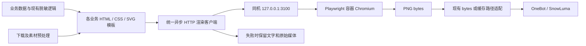

# 图片渲染盘点与统一方案

调查日期：2026-11-01（Asia/Shanghai）。最后一次运行验证：17:12:44 +08:00。

本轮范围：用户选择“先盘点并给修正方案”。只读取代码、配置和进程信息，向现有渲染服务提交一次无业务数据的测试 HTML；未修改业务代码、服务器配置，未部署、重启或发送 QQ 消息。测试使服务成功渲染计数增加 1。

## 结论

目前没有统一使用同机 Playwright 容器。

- 9 类卡片用途中，7 类使用机器人宿主机上的 Pillow 排版；2 类（灾害预警、终末地）通过 HTTP 使用同机 Playwright。
- Playwright 实际由宿主机 `qqbot-playwright-renderer.service` 运行，监听 `127.0.0.1:3100`。服务器 Docker 的运行及停止容器列表中均没有渲染容器。
- 仓库已有 Docker 模板，但端口、依赖版本和字体与实际宿主服务不同，不能直接按现有模板切换。
- 建议统一“卡片排版和截图”到同机容器。现成媒体转发、缩放、压缩、格式转换、GIF/PDF 组装和二维码编码继续使用相应工具。状态卡保留用户已选的 D「浅色泡泡」外观。

## 调查依据与限制

本地工作区为 `D:\Software\qqbot`；服务器为 `root@192.0.2.226`，项目目录 `/opt/qqbot`。扫描了本地和服务器 `nonebot` 运行源码，沿插件调用核对出图函数；测试、历史原型、缓存和第三方依赖目录不计为独立业务入口。另检查了 MuiceBot 媒体相关实现，未发现额外的卡片绘制入口。

对 33 个相关源文件计算 SHA-256，并归一换行后比较：全部一致。它们涵盖主要绘图模块、调用插件、两个 HTTP 客户端及渲染服务四个部署文件。此结论指检查时的磁盘文件，不代表整仓一致，也不代表所有分支都已上线；本轮没有逐个发送业务指令验证进程已加载的所有模块。

调查证据保存在本地 `D:\Software\qqbot\.tmp\render-audit-20261101\`：

| 文件 | 内容 |
| --- | --- |
| `local-inventory.json` / `server-inventory.json` | 文件指纹、运行源码命中位置、白名单渲染配置、Python 包版本 |
| `comparison.json` | 33 个文件比较结果 |
| `runtime-evidence.json` | 服务、容器、版本、字体匹配和一次 PNG 实测 |
| `renderer-smoke.png` | 无业务数据的中文测试图片 |
| `inventory.py` / `collect.py` / `probe_server.py` / `probe.py` | 本次调查脚本；未在服务器落盘 |

配置读取仅提取渲染 URL、超时、开关等白名单字段；没有导出令牌、Cookie 或完整环境变量。

## 卡片入口清单

以下源码位置均相对于工作区根目录，行号对应调查时的文件。天气和群话题共用一个绘图模块，因此按业务用途为 9 类，并非 9 个独立引擎。

| 用途 | 插件入口 → 绘图实现 | 当前方式、返回值 | 统一方案 |
| --- | --- | --- | --- |
| 帮助菜单 | `nonebot/plugins/gate.py:276` → `nonebot/help_image.py:98` | Pillow；PNG 缓存文件路径，随后转换为协议容器可见路径 | HTML 命令分组与双列排版，PNG 仍写可共享缓存 |
| 天气查询、定时天气 | `nonebot/plugins/weather.py:46` → `nonebot/weather_image.py:36` | `asyncio.to_thread` 调用 Pillow；PNG bytes，失败回退文字 | HTML 天气模板，沿用现有文本及失败回退 |
| 群话题 | `nonebot/plugins/group_topics.py:50` → `nonebot/weather_image.py:36` | 共用天气 Pillow 模板；本地 Semaphore(1) | 与天气共用基础 HTML 模板，标题和来源独立 |
| Epic 喜加一 | `nonebot/plugins/epic_free.py:104` → `nonebot/epic_free_image.py:80` | Pillow；PNG bytes，保留链接和文字回退 | HTML 免费游戏列表，保留领取链接和时间语义 |
| 服务器状态卡 D | `nonebot/plugins/statuscard.py:513` → `nonebot/status_image.py:423` | Pillow；1170 px 基准排版，再按配置缩放；本地角色背景 | HTML/CSS/SVG 复现 D 外观，继续使用已有脱敏 view |
| 状态日报、周报 | `nonebot/plugins/statuscard.py:879` → `nonebot/status_image.py:715` | Pillow；动态高度、表格和趋势图 | HTML 表格与 SVG 趋势图，长报表按章节分页 |
| 多平台链接解析预览卡 | `nonebot/media_parser/core/sender.py:158` → `nonebot/media_parser/core/render.py:482` | Pillow + Apilmoji；缓存 PNG 路径；含头像、封面、图文、嵌套转发和 Emoji | 保留 ParseResult/发送计划，单独替换排版实现，放在最后迁移 |
| 地震、气象、台风、海啸卡 | `nonebot/plugins/disaster_warning.py:710` → `nonebot/disaster_render.py:337` / `:389` | 自包含 HTML/SVG → HTTP `/render` → 宿主机 Node Playwright → PNG bytes | 保留现有模板；切同机容器并接入统一 HTTP 客户端 |
| 终末地图卡 | `nonebot/plugins/endfield.py:322` → `nonebot/endfield/cards.py:25` / `nonebot/endfield/render.py:54` | 自包含分页 HTML → HTTP `/render` → 同一宿主机 Playwright；失败文字回退 | 保留当前分页与模板，统一客户端和容器入口 |

灾害气象地图由 `nonebot/disaster_weather_map.py` / `nonebot/disaster_weather_card.py` 提供 SVG/HTML 内容，最终仍由上述 Playwright 服务截图，不是另一个图片绘制后端。

服务器另外留有根目录 `nonebot/statuscard.py`（也导入 `status_image`）及 `nonebot/weather_image.before-topics.py`。它们没有形成新渲染方式。当前主要调用路径来自 `plugins/`；本轮未删除这些副本，也未将残留文件本身等同于已加载插件。

## 应保留的图片处理

| 用途 | 源码 | 职责与建议 |
| --- | --- | --- |
| 游戏活动封面 | `nonebot/game_event_message.py:81` | 下载原图后执行 EXIF 方向修正、缩放、透明背景处理、JPEG 编码；直接转发现成图片，保留 Pillow |
| 看图输入规范化 | `nonebot/image_logic.py:101` | 调整输入图片尺寸、方向及格式供模型读取；保留 Pillow |
| 小红书媒体 | `nonebot/media_parser/core/parsers/xhs.py:140` / `:226` | 获取尺寸、修正扩展名、HEIF/HEIC 转 JPEG；保留 Pillow/pillow-heif |
| Pixiv 媒体 | `nonebot/media_parser/core/parsers/pixiv.py:221` / `:244` | 图片集合转 PDF、动图帧组装为 GIF；保留 Pillow |
| B 站登录二维码 | `nonebot/media_parser/core/parsers/bilibili/login.py:105` | qrcode 生成 PNG，属于二维码编码；保留 qrcode，无需启动浏览器 |
| 普通图片、封面、头像等资源转发 | 各解析器、MuiceBot 媒体处理 | 文件/URL 读取及投递不算卡片排版；保留现有下载、缓存和协议发送方式 |

`nonebot/plugins/token_usage.py` 的统计在管理面板中用 HTML 展示，没有独立的聊天图片生成入口。本轮未发现运行源码中另行使用 Selenium、Python Playwright、matplotlib、cairosvg 或 imgkit 出图的路径。

## 服务器实际运行状态

| 检查项 | 结果 |
| --- | --- |
| qqbot / dashboard / renderer | 三个 systemd 服务均 active |
| renderer 进程 | PID 71981；`/usr/bin/node server.js` |
| 服务路径 | `/opt/qqbot/docker/playwright-renderer` |
| 实际绑定 | `HOST=127.0.0.1`、`PORT=3100`、`MAX_CONCURRENT=2` |
| Node | v18.19.1 |
| Node 依赖 | vendor 中 `playwright` / `playwright-core` 均为 1.60.0；browser 清单为 Chromium revision 1223（清单值，未另行查询运行中的浏览器版本） |
| 浏览器目录 | `/root/.cache/ms-playwright` |
| Python | Pillow 13.0.0、httpx 0.28.1、MuiceBot 1.1.5；Python Playwright 未安装；加入运行时 parser_deps 路径后 qrcode 为 8.2 |
| 字体匹配 | WQY 与 Unifont 可匹配；请求 Noto Sans CJK SC 时匹配为 DejaVu Sans，不能按已有 Noto 环境设计 |
| Docker 全部容器 | `mcs-daemon-1`、`mcs-web-1`、`qqbot-snowluma`；没有 Playwright 容器 |
| 灾害有效配置 | render.enabled=true、remote_url=`http://127.0.0.1:3100`、timeout=20s；container_name 字段为 `host-playwright`，不代表真实 Docker 容器 |
| 终末地有效配置 | render_url=`http://127.0.0.1:3100`、render_timeout_seconds=20 |
| 端口 3000 | 已被另一宿主进程占用；此次仅确认监听和 PID，未调查其业务 |
| 实测渲染 | HTTP 200、Content-Type=image/png、900×400、27,170 bytes；服务报告 63 ms；中文可读 |
| health 实测 | 成功计数 13→14、失败计数保持 1、active 回到 0；既有失败未在本轮复现，未调查其历史原因 |

上述 63 ms 是单张简单卡片的服务端计时，不是复杂卡片性能结论。容器性能、故障恢复、极限并发尚未实测。

## 迁移前需要修正的事项

| 优先级 | 证据 | 影响 | 建议修正 |
| --- | --- | --- | --- |
| 高 | `docker/playwright-renderer/docker-compose.yml:8` 映射 `127.0.0.1:3000:3000`；服务器 3000 已占用 | 直接启动模板会发生端口冲突 | 正式入口沿用 3100；预检容器先使用经确认空闲的 3101 |
| 高 | Dockerfile/package.json 钉为 1.49.0，宿主 vendor 为 1.60.0 | 直接容器化会同时改变浏览器、运行库和字体环境，无法把视觉或行为差异只归因于容器 | 选择同一组可复现的镜像、npm 包与浏览器版本，写锁文件并在候选容器实际出图验证；不把旧 1.49.0 模板视作当前已验证环境 |
| 高 | `server.js:12–14,127–147` 限制宽 1600、高 2400，`fullPage:false` | 当前 Pillow 菜单、日报和解析长图可能更长；直接迁移会截底部，超限参数还会被静默钳制 | 客户端分页；服务检测内容溢出并返回明确错误。不要简单取消所有尺寸限制 |
| 高 | `server.js:9,76,121` 对完整 JSON 请求和 HTML 都有 2 MiB 上限 | 检查 HTML 长度通过，不代表包含 JSON 转义开销的实际请求能通过；内嵌多张原图很容易超限 | 以编码后的请求 bytes 检查预算；预处理素材并按页限制；遇到 413 明确回退 |
| 高 | `server.js:183–189` 在 await readJson 前检查 active，读完 body 后才加 1 | 多个同时进入的请求可在 active 增加前通过检查，配置的并发 2 不是严格上限 | 读取/接纳阶段原子占位或增加有界队列，并在所有退出路径释放；规定请求体读取期限 |
| 中 | `server.js:38–57,157–161` ready 仅验证能 require 包；Docker HEALTHCHECK 仅判断 HTTP 2xx | 浏览器不存在或崩溃时仍可能显示健康 | 分开存活和就绪语义；启动完成一次最小真实渲染后才 ready；浏览器断开时清空缓存实例并恢复 |
| 中 | `disaster_render.py:337` 仅检查 image/* 和非空；Endfield 客户端严格校验 PNG，且配置独立 | 故障处理、超时及输出协议不一致，未来每个插件容易再写一套 | 建立独立公共 HTTP 客户端，统一 PNG 签名、状态码、时限、连接关闭与日志 |
| 中 | 帮助/解析器返回路径，其他模块多数返回 bytes；协议端在 SnowLuma 容器中 | 只迁移截图却换了落盘目录，会出现渲染成功但发送失败 | 客户端统一返回 PNG；帮助和解析器适配层继续写协议端可见缓存并复用路径映射 |
| 中 | 当前图卡字体、Emoji 来源和部署模板字体不同 | 中文行高、长标题换行和 Emoji 可能改变，影响 D 方案及解析卡 | 固定字体与素材；在同一候选容器做固定样本视觉对照 |

这里只做静态问题识别，没有向运行服务施加并发压力或故障注入。浏览器恢复和并发边界问题应在候选容器复现与验证。

## 推荐目标结构

建议新建独立原创公共客户端（例如 `nonebot/render_client.py`），只负责传输、限流、超时和错误归类。业务模板继续归各模块所有，不做一个包含所有业务字段的大模板。灾害和 Endfield 先经现有包装函数委托它，逐步兼容旧配置，最终面板只保留一个有效服务地址及就绪状态。

客户端拟统一提供 `render_html(html, width, height, timeout_ms) -> bytes`。对一组页面由上层逐页调用；返回 PNG 的入口保持简单。建议共用连接池、设置小型有界等待队列；交互命令优先于批量定时任务；429 仅在剩余总时限内有限重试，服务中断时尽快退回文字。最终每一类卡片都使用同一后端，迁移期间允许按功能开关灰度及回滚，但不静默用 Pillow 重新绘制卡片来掩盖容器失败。

服务器继续只接收自包含 HTML/SVG/data 图片。外部资源先由机器人已有下载模块处理，再嵌入页面；固定字体预装在镜像内，避免每次把字体编码进请求。保留禁用页面脚本和外部请求的现有约束，不为截图服务开放 Docker socket 或整个宿主机目录。

为服务增加按调用来源统计的成功数、失败原因、队列等待、截图耗时和输出尺寸，不记录原始 HTML、敏感 view 或登录二维码。容器 CPU、内存、进程数预算在候选负载测试后固定；仍从并发 2 开始验证，不因覆盖功能变多就直接提高并发。

## D 方案及长图兼容

1. **保留当前信息结构和外观。** 顶部达妮娅横图、粉蓝浅紫底、白色圆角面板、身份与在线状态、资源环、磁盘、网络、网站探测、进程/系统并列、QQ 统计和页脚全部沿用。警告/危险颜色与现有脱敏语义继续生效；HTML 模板接收已经脱敏的 view。
2. **背景仍为已有本地素材。** `nonebot/resources/statuscard/denia-bubbles.jpg` 为 1,175,864 bytes，直接 base64 后约 1,567,820 bytes，还未算 HTML、头像和 JSON。生成适合 1170 px 排版的压缩版本，并以视觉对比决定质量；源文件及来源记录保留。背景损坏时仍使用浅色底。
3. **字体预装，不能整份内嵌。** 现用 `HYSongYunLangHeiW-1.ttf` 为 3,726,528 bytes，单独就超过接口上限。镜像中安装同一字体或经确认的替代字体，校验实际字体匹配；保留资源与代码各自的来源记录。
4. **1170 px 排版与输出宽度分开。** 当前状态卡允许 760–2880 px 输出，而服务 viewport 最大宽度为 1600。首轮建议始终以 1170 px 排版截图，沿用现有 Pillow 输出缩放，以保留宽度配置；这属于图片后处理。后续若引入浏览器像素倍率，也必须同时限制总像素数。
5. **按内容分页。** 普通 D 卡保持一张；超出限额时在面板边界分页，日报按章节、菜单按分组、解析卡按内容块分页，避免截半行。服务应校验页面实际尺寸，发现溢出不能返回一张看似成功的截断图。
6. **日报不加人物横幅。** 保持现有浅色报表和章节布局。默认、760 px 窄版、精简、长文本、更多磁盘/网站和日报分别进行对照。既有参考位于 `docs/research/statuscard-background-preview/selected/`，上次服务器实际 D 图位于 `.tmp/integration-20261031/server-statuscard-live-D.png`；使用固定脱敏数据重新生成成对基线，不能拿实时数值差异当视觉回归。

解析卡应单独处理嵌套转发、图片网格、纵横封面、缺失图片和 Emoji。已有 Apilmoji 会获取 Emoji 图片；新模板需先解析并缓存为内嵌素材或使用已验证字体，不能依赖被服务禁止的 CDN 外链。迁移期间保留当前“预览卡独立发送、媒体按原计划转发”的语义。

现有代码文件头和 `docs/third-party/` 中的来源、许可记录应随迁移保留。公共传输层独立编写，不直接复制某个衍生插件客户端作为全仓通用实现。这里只沿用仓库现有来源边界，不重新判断第三方许可。

## 实施顺序与验收

| 阶段 | 工作 | 完成条件 |
| --- | --- | --- |
| 0：固化候选版本 | 确认当前部署文件、用户选定 D 资源和 main 已合入改动的合集；在隔离候选目录整合 | 文件清单可复现；不覆盖正在修改的解析器代码，不遗漏未跟踪功能 |
| 1：容器与公共客户端 | 修端口、版本锁定、字体、实际就绪、浏览器恢复、严格并发；候选端口 3101；先接现有灾害/Endfield | 两类现有模板真实 PNG、中文、分页和文字回退通过；镜像与依赖版本有记录 |
| 2：简单卡片 | 天气 → 群话题 → 帮助菜单 → Epic | 查询/定时路径都接通；帮助文件能被协议容器读取；文字、链接和缓存行为正确 |
| 3：D 状态卡及报表 | CSS/SVG 复现 D，固定字体、素材和脱敏 view；兼容宽度及分页 | 默认/精简/窄版/长内容对照通过；报表不丢章节；背景缺失可用 |
| 4：解析预览卡 | 替换 Renderer 排版，兼容 ParseResult、缓存、Emoji、嵌套与发送计划 | 常见平台和全部主要布局通过；预览卡不重复发送；原媒体失败/重试语义保持 |
| 5：正式切换与收口 | 保存旧配置和可启动的 systemd 回滚单元；停止旧监听后让候选容器接管 3100；统一面板和运维文档 | 端口仅回环；每种卡片后端可观测；故障可回滚；旧 Pillow 卡片布局代码在验证后退役 |

阶段 1、5 是未来实施计划，本轮没有启动容器或停止任何服务。若 3101 并非空闲，预检时应重新选择已确认空闲的回环端口。正式切换只能有一个服务占用 3100；回滚时先停容器，再启旧 systemd 单元。简单卡片迁移不必等待复杂解析卡一次性完成。

建议验证矩阵：

- 公共客户端使用现有 httpx 测试方式覆盖 200 PNG、错误内容类型/签名、空响应、413、429、5xx、超时与连接关闭；测试完整 JSON 请求大小，不只测试 HTML 字符数。
- 候选容器验证中文、Emoji、图片解码完成、字体加载完成、超长内容分页；故意缺图时有明确退化。使用真实 PNG 尺寸和视觉检查，不以 `/health` 200 作为唯一通过依据。
- 仅在候选容器验证 2 并发边界、队列耗尽、浏览器进程退出后的恢复、重启后就绪以及请求超时清理；不向当前运行机器人做破坏性故障测试。
- 每类卡片至少有固定正常和边界样本；D 方案保留信息结构、配色、人物位置和可读性，允许浏览器与 Pillow 字体抗锯齿差异，不要求逐像素一致。
- 断开候选渲染服务后，命令和定时任务仍能提供文字或原媒体；状态隐私选项在 HTML、PNG、日志中都有效。
- 所有卡片均能从可观测记录确认使用容器渲染；图片压缩、转码和二维码继续使用 Pillow/qrcode 不判为迁移失败。

## 版本与后续部署注意

调查时本地分支为 `codex/game-events`，HEAD `0a33293`；`main` 与 `origin/main` 均为 `8ee55ef`。工作区有大量未提交及未跟踪文件，包含当前运行功能和其他会话的解析器修改。服务器 Git HEAD 仍为 `52d12e0`，但相关部署文件与本地盘点的 33 个文件一致，说明不能仅凭服务器提交号判断实际运行功能。

后续容器迁移应先基于部署清单形成完整候选版本，再按用户已选择的现有 `main` 整合；不能直接把旧 Git 检出覆盖服务器，也不能认为上轮分支合并已自动部署。当前 D 设计文档仍记载“继续 Pillow 本地渲染”，这是既有实施状态；待迁移方案被选定并实施后，再同步更新设计说明、OPERATIONS、配置默认值和面板文案。

本轮交付止于以上盘点与修正方案。
