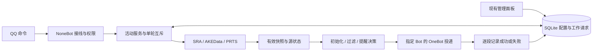

# 游戏活动日历移植设计（已确认，含会话限制补充）

日期：2026-10-31（北京时间）  
目标仓库：`Lkyloveaw/denia-bot`，工作目录 `D:\Software\qqbot`  
参考项目：`XinDuKW/astrbot_plugin_game_event_due`，v1.1.1，固定提交 `daeb265ef42b7a576cf70f646d2859a68ec01fd6`  
状态：**2026-10-31 用户批准方案并要求面板独立管理项、参照链接解析器的会话限制；进入实施。**

用户先要求研判与完整设计，随后明确批准，并补充「两个约束都做，类似当前链接解析器的设置」。证据与联网验证边界见 [研判报告](../../research/game-event-due-port.md)。

## 本次批准后的补充：管理入口与会话限制

现有面板提供独立「游戏活动」导航与管理区域，统一管理全局设置、订阅、源状态、预览、刷新及紧急目标。会话限制和链接解析器一致：whitelist / blacklist 使用 `group:群号`、`private:QQ号`，黑名单优先，白名单非空时仅允许列入的会话，白名单为空不限制。另提供 group_enabled / private_enabled 两个总开关，默认开启；初始没有订阅和紧急目标，因此不会主动发送。

所有命令（包括超管在群内查询）、订阅初始化、普通定时推送、紧急私聊、手动检查投递均复查同一策略。被禁用的群内命令静默消费，既不发拒绝提示也不交给聊天模型。私聊停止/确认可以清理本人已建立的提醒状态，但被禁止的会话不回复、不测试投递。紧急目标来源于群时保存 origin_session；来源群被移出可用范围后也暂停该目标，防止群限制通过私聊绕过。

面板修改使用 revision 防止覆盖，策略在每次发出消息前读取；名单收紧不删除原订阅，界面显示「已被访问策略暂停」，恢复允许后按当前档位继续。面板保存订阅可保留被策略禁用的目标，不能因保存而绕过策略发送。

## 1. 建议与目标

建议按功能移植，使用本项目现有的 Python、NoneBot2、MuiceBot、OneBot v11 和管理面板，重新实现游戏活动日历。覆盖上游的 10 个游戏/区服入口、查询、会话订阅、新活动与到期提醒、过滤、图片、合并转发、紧急私聊和后台管理。

上游仓库的当前树未包含 LICENSE，GitHub 的 license 字段为 null。因此本方案不直接复制其 Python、前端、测试或图标；记录功能参考来源，依据公开接口与行为需求自行实现。此处是来源处理方案，不把「公开可读」当作已经取得代码再分发授权。

成功标准：用户能在现有机器人里查询并订阅游戏，活动临近结束时按设定收到有限次数的提醒，重启后不会从头重复；管理员能在现有面板查明订阅、源状态和发送失败原因。插件不调用 LLM，不要求游戏账号或抽卡凭证。

## 2. 方案比较与拟采用方案

| 方案 | 收益 | 代价及限制 | 建议 |
|---|---|---|---|
| 另起 AstrBot 运行原插件 | 原运行框架内功能最接近上游 | 多一个机器人运行时、配置与管理入口；与本仓库现有接入方式分离；源码授权问题仍需单独处理 | 不采用 |
| NoneBot 原生实现，保持 SRA + AKEData + PRTS 三源 | 保留 10 个入口、终末地卡池及方舟兑换截止时间；复用当前面板、权限和部署 | 三类协议分别维护；需要处理 AKE 表缓存和 PRTS 限流 | **本设计的推荐方案，待用户批准** |
| NoneBot 原生实现，统一使用 SRA | 数据适配器更少；SRA 当前文档已列方舟、终末地入口 | 与原三源方案的覆盖、新鲜度、额外时间字段尚未完成等价核验；不能仅凭端点存在就替代 | 保留为后续简化方向，本轮不自动切换 |

SRA 的 `ak` / `end` 新入口及 `kind` / `pools` 字段见其[公共 API 文档](https://starrailassistant.top/reference/public-api/)。它们不使本轮游戏范围自动扩张，也不使不同来源的活动被混合去重。

## 3. 范围与兼容边界

| 能力 | 拟实现行为 |
|---|---|
| 支持游戏 | `sr` 崩铁、`ys` 原神、`zzz` 绝区零、`ww` 鸣潮、`nte` 异环、`ba-cn` / `ba-global` / `ba-jp` 蔚蓝档案三个区服、`endfield` 终末地、`arknights` 明日方舟 |
| 名称解析 | 支持代码、中文全名和上游已列出的常用别名；「蔚蓝档案/碧蓝档案」展开三个区服；未知参数整体报错，不悄悄订阅其中一部分；模糊子串命中多个非同系列游戏时列出候选 |
| 活动查询 | 展示未结束活动，分进行中/即将开始，紧急者在前；无参数使用当前会话订阅；无订阅时给出用法，不默认请求全部游戏 |
| 订阅与退订 | 按机器人账号 + 群或私聊分别保存；重复订阅幂等；退订全部只影响当前会话 |
| 提醒 | 新活动一次；默认结束前 7 / 3 / 1 天；同轮新活动和到期条件合并；已过期和无有效结束时间的记录不提醒 |
| 过滤 | 名称、描述、分类标签，不区分大小写；白名单非空需至少命中一项，黑名单命中即排除；查询和主动推送使用同一会话过滤器 |
| 封面 | 全局默认图片；会话可选图片/链接/关闭/默认；压缩失败、超预算或下载失败降级为安全链接 |
| 合并转发 | 可选、默认关闭；每游戏一条，按活动组织节点；不支持或明确拒绝时回退普通消息 |
| 紧急私聊 | 保留为默认关闭的可选功能；独立目标、确认、停止、静默时间、频率与每日上限，详见第 8 节 |
| 管理面板 | 集中管理订阅、规则、源状态、缓存预览、刷新任务与紧急目标，复用现有登录和 CSRF 保护 |
| 帮助 | 注册所有中文命令和英文别名，并在 `.help` 添加「游戏活动」分组与权限说明 |

不包含：游戏签到/领取/代打、读取玩家账号、用户游戏进度、导入 AstrBot KV 数据、多平台适配、LLM 生成活动时间、自动增加新游戏、日历订阅协议、生产部署。原插件配置和 UMO 不直接导入；这里没有已经发现的旧活动订阅数据需要迁移。

## 4. 命令与权限

采用 `on_message` 显式解析完整命令，优先级参考现有天气/Epic 插件（拟为 3），命中后阻断后续聊天。只处理 OneBot v11 消息事件，私聊和群聊均支持 `/`、`.`；中文完整命令也支持裸写。英文别名及短别名「活动」必须有前缀，避免截获日常聊天。非法命令参数返回用法，不落入 LLM。

| 中文命令 | 英文别名 | 普通私聊用户 | 普通群成员 | 群主/群管理员 | 超级管理员 |
|---|---|---|---|---|---|
| 活动查询 / `/活动`、活动游戏、活动列表 | `game_query` / `game_games` / `game_list` | 查询自己会话 | 查询当前群 | 查询当前群 | 同左 |
| 活动订阅、活动退订 | `game_sub` / `game_unsub` | 仅自己 | 拒绝修改群配置 | 仅当前群 | 当前会话；任意目标在面板操作 |
| 活动过滤、活动封面、活动开关、活动阈值 | `game_filter` / `game_cover` / `game_toggle` / `game_threshold` | 仅自己 | 拒绝修改群配置 | 仅当前群 | 同上 |
| 活动状态、活动刷新 | `game_status` / `game_refresh` | 拒绝 | 拒绝 | 拒绝 | 允许 |
| 活动私人提醒 自己/停止/测试/列表 | `game_dm` | 仅自己 | 仅自己 | 仅自己 | 可管理其他目标 |
| 活动私人提醒 @某人 / 移除 @某人 | `game_dm` | 拒绝指定他人 | 拒绝 | 拒绝 | 允许；必须明确游戏范围 |
| 我已知晓 [活动名或编号]、`/已知晓` | `game_ack` | 仅自己的待提醒活动 | 仅自己的待提醒活动 | 仅自己的待提醒活动 | 仍仅本人；他人设置走面板 |

权限读取当前 `driver.config.superusers`，不缓存启动时名单；群权限从当前消息的 sender.role 取 owner/admin。普通成员修改群规则时简短提示权限要求并结束。测试、停止、确认在群中执行时落到执行者的私聊身份，不改变群订阅，不公开其他人的提醒清单。

查询有每用户 10 秒、每会话 10 秒冷却；查询共用抓取缓存，不能绕过源请求最小间隔。管理刷新每机器人 60 秒一次且不能并行执行同一轮。单条查询最多指定 10 个游戏；分段展示上限见第 9 节。

主命令之外保留上游已声明的辅助别名，并集中列入命令表和测试；不照搬其全消息「知道了」关键词监听，防止普通对话误确认。`我已知晓` 是完整命令；`已知晓` 需前缀。

## 5. 默认设置与状态含义

| 项目 | 提议默认值/限制 |
|---|---|
| 时间 | 内部统一带时区的 UTC 时间；展示、静默和每日计数用 UTC+8；无时区源时间按该适配器的明确约定解释并覆盖测试 |
| 轮询 | 30 分钟，允许 15–180 分钟；只抓取订阅或紧急目标需要的游戏；首次启用无目标，不发消息 |
| 查询缓存 | 5 分钟；同游戏并发查询合并为同一次抓取；管理员刷新仍服从源限流 |
| 请求 | 20 秒超时；普通 JSON 上限 5 MiB，AKE 文本表上限 32 MiB；状态中单列超时、限流、格式错误 |
| 默认阈值 | `[7, 3, 1]` 天；接受 1–365 的正整数，至多 10 档，去重降序；非法内容拒绝保存；空列表表示关闭，null 表示继承 |
| 源开关 | SRA/AKEData/PRTS 分别可关闭，默认开启；关闭后暂停该源抓取与推送，保留订阅/状态；查询明确标「源已关闭」及可用旧缓存，不自动换源 |
| 新活动 | 开启；开始时间距今最多 45 天；每会话每游戏每轮最多 8 个纯新活动，未发送的留到后续轮次 |
| 倒计时 | 仅已开始或开始时间缺失的活动；边界为 `0 < end-now <= 阈值`；显示「剩余不超过」避免边界文字歧义 |
| 暂停 | 会话或全局推送关闭时仍允许查询；不推进通知状态；恢复时按当前最紧急档计算，不补发错过的各个历史档 |
| 缓存失败回退 | 查询可展示不超过 7 天的最后成功快照，明确成功时间与失败提示；主动提醒仅在最后成功核验距今不超过 6 小时时使用缓存，并标注缓存；超过则该源暂停推送 |
| 保留 | 已结束活动与提醒记录保留 30 天后清理；请求日志与发送记录保留 30 天；不按一次源缺项立即删除活动身份 |
| 资源限制 | 最多 200 个会话、每会话 10 个游戏、每类过滤词最多 50 个/每词 64 字；超过明确拒绝，不静默截断订阅 |

「成功核验时间」与「源数据更新时间」分开：HTTP 304 可证明源端内容没有变化，不能证明其活动日历已经按新版本更新。版本已过期、全是过期条目、部分记录缺字段都显示诊断信息；不把这些情况渲染成数据一定完整的「目前没有任何活动」。合法空数组允许保存，但保留上次快照供诊断。

## 6. 普通提醒的确定行为

### 6.1 首次订阅

1. 校验权限、游戏和配置，事务创建订阅及新的订阅代次，记为「等待初始化」。重复添加同游戏不重建代次，不重发概览。
2. 获取该游戏有效快照。已有近期快照可用于概览；没有可用数据时保留订阅、提示暂不可用，首次成功抓取后再初始化。
3. 默认发送当前活动概览。保存本次初始化快照，逐段记录概览发送结果；全部概览段成功后，事务把该快照中符合过滤和预告窗口的活动记为已知，并把已达到的最紧急档作为基线；因而概览后的下一轮不会再发同一批到期提醒。
4. 概览失败时保留未完成部分，下一轮重试；等待初始化期间不同时执行普通提醒。活动在重试前已结束则移出概览，不发送过期提醒。
5. 若关闭「订阅后概览」，第一次有效快照只建立基线，不发送。超过 45 天预告窗口的活动不提前记为新活动已通知，进入窗口后才可通知。
6. 面板新建订阅和聊天订阅采用同一初始化流程；面板只提交配置，发送由机器人负责。

概览超过30项时，只展示最紧急的30项，并在最后一段明确提示「另有N项，已纳入订阅，可在面板查看」。最后一段成功后，其余同快照项目也建立基线，不在后续轮次作为漏发的新活动刷出。概览重试沿用初始化快照与逐段进度，剔除已结束项；初始化期间后来才出现的活动，在进入 ready 后按普通新活动规则处理。没有可发送项目时直接完成初始化。

### 6.2 稳定身份、档位和过滤

活动身份优先使用来源稳定 ID，并包含游戏与活动期次；来源没有 ID 时用标准化名称 + 开始时间 + 内容类别生成确定性摘要。不可使用 Python 运行时 hash 或数组位置。结束时间、封面和描述变化不制造新活动；开始时间修订可能改变无 ID 源的期次身份，记录为已知限制，不用模糊名称合并不同期。

实施补充：开始时间缺失时使用固定空标记，不把可变结束时间纳入身份；来源也没有 ID 时退回标准化名称。同游戏无ID、无开始时间且完全同名的不同期无法可靠区分，这是上游字段不足的边界；保留延期去重，避免一改截止时间就重新催办。

对一个活动计算符合的最小阈值。例如剩 5 小时，只产生 1 天档；已有 3 天档只允许继续向 1 天推进。关闭或修改档位不清除历史：新增的更宽松档不补发，确实更紧急的档仍可发送。延期时保留已发档位，不倒退、不再次报同档；查询始终显示最新结束时间。

过滤在新活动、倒计时、概览与查询前应用。取消过滤后，原来不可见且仍有效的活动可成为该会话的新活动，受每轮数量上限约束。订阅代次实际按「会话 + 游戏」保存：退订某游戏只失效该游戏的待发送计划；重新订阅该游戏生成新代次并建立基线，不影响同会话其他游戏。

### 6.3 发送、失败与一致性

每轮先获取快照，再生成计划，按会话/游戏拆分投递。一个源失败不阻断其他源，一个群失败不阻断其他目标。普通定时消息每目标至少相隔 2 秒，每次发送超时 20 秒。

消息成功后，在独立短事务中记录其中包含的活动/原因；发送失败不记录成功。同游戏分为多段时逐段确认，仅失败段重试。请求超时不能证明 QQ 没收到，记为「结果未知」，不立即换消息形态重发，下一轮仍可能重试。

这提供失败后的可重试性，**不承诺严格只发送一次**：平台已接收但回执丢失，或进程在发出消息后、写入数据库前崩溃，仍可能重复。正常成功回执、重启、重复轮询和并发刷新应去重。OneBot 没有本方案可依赖的端到端幂等键。

网络调用不放在 SQLite 写事务中。每次发出前复查订阅代次、开关和修订号，丢弃已失效的计划；发送后只更新对应活动状态，不把整份旧订阅覆盖回数据库。刚好已经在途的消息在退订时可能仍到达一次，此后不再投递。

## 7. 三个来源的接入约定

| 源 | 映射与解析 | 缓存/限流 | 失败语义 |
|---|---|---|---|
| SRA | 8 个原入口；解析 `activities` 的名称/描述/起止时间/cover，将可选 kind 放入标签；未知新增字段忽略。原 8 游戏默认不额外引入 pools | 按游戏 ETag/Last-Modified；304 必须返回此前完整快照；304 且无缓存时只重试一次无条件请求 | HTTP 200 错误体、缺 activities、非数组均是协议错误；单条坏时间丢弃并计数，全部候选均无效时不能覆盖有效快照 |
| AKEData | manifest 选择 latest 对应版本；Activity/TimeRange/ActivityTag/中文文本表联接；可选 GachaCharPool；每个有效 timeRangeList 区间各形成一个期次，身份包含源条目ID和开始时间，重复区间去重；无明确结束时间的常驻条目排除；不下载 CharacterTable | 按 manifest 版本复用已下载表；中文表以 gameVersion 分区；manifest修订变化时按HTTP验证器重新核验中文表，无验证器则重新下载，不能只凭大版本相同忽略hotfix。先完整解析并持久化，再清理旧表；活动与卡池开关参与解析缓存版本 | manifest 或表数据失败保留上次完整活动快照；缓存必须能在重启后恢复；304 回退不能把当前表当空对象 |
| PRTS | 一次 SMW ask 取活动名称/开始/结束/兑换结束/活动页；跟随续页直到结束；过滤维护分类 | 全源请求最小间隔 20 秒，包括续页；最多 5 页，每页显式 limit=100；查询截止日期是请求/缓存键的一部分 | 403/429 不密集重试；不宣称已有 ETag 支持，先用有时间标记的完整快照；续页失败或达到上限仍有后续时标为 partial，不替换完整快照 |

数据源之间不自动串换，不同时合并两个源的同款游戏。每个游戏只对应一条活动身份空间。今后若切换到 SRA `end`/`ak`，需单独设计映射和重新建基线，避免全量「新活动」。

PRTS 的兑换结束时间只随仍在展示的活动附带显示，不产生独立兑换提醒；活动本身结束后退出活动列表，即使兑换仍开放。本轮如要扩展到商店关闭提醒，需要另行增加里程碑与通知状态，不能把活动结束时间直接改为兑换结束。

AKE 表、资源 URL 仅从已核验的基址和安全相对路径构造，拒绝绝对外域与 `..` 路径；代理只允许管理员通过部署环境设置，面板不回显带凭据的代理地址。本轮不开放任意 API URL 配置。

**联网验收边界：**本轮可读取上游代码、SRA 官方文档及浏览工具取得的部分 API 快照；开发机直连与 AKE/PRTS 成功抓取未全部验证。实现阶段必须在实际部署网络上复核，不能把缓存页面当作生产实时连通性证明。

## 8. 紧急私聊的独立规则

紧急提醒默认关闭。开启后，每个目标保存机器人账号、QQ、明确的游戏集合、过滤规则、启用状态；只使用目标自己的私聊订阅，或设置命令时显式确认/保存的游戏集合。**不取机器人所有群订阅的并集**。在群中把自己加入时，复制当前群所订游戏及过滤规则为目标快照，并在回执列明；以后群规则变化不暗中扩张个人范围。

超级管理员可指定其他 QQ，回执必须列出目标和游戏。没有可确定的游戏集合时拒绝创建并要求补充。群管理员不能替其他人配置私聊催办。

默认只催进行中的活动，剩余不超过 1 天；每目标每 120 分钟最多一条汇总，每自然日最多 3 条，UTC+8 的 23:00–08:00 静默。重复间隔允许 5–1440 分钟，每日上限允许 1–20，首版不开放无限次。

全局推送关闭也暂停紧急提醒；某个群的推送关闭不修改已经独立建立的个人紧急目标，面板和回执写明这一点。静默/日限/间隔拦截不标记已发；成功才推进 last_sent 和日计数。已到期活动直接移除，不在静默结束时补发过期内容。

确认只作用于执行者已存在的待催活动；无参数确认当前全部，带活动名/短编号确认匹配项，无匹配明确提示。确认保留到该期活动结束，下一期仍按新身份提醒；`停止` 则关闭目标，只有显式重新开启才恢复。测试仅向执行者本人发送一条无活动的验证消息，独立 60 秒冷却，不把群里其他成员作为隐含测试目标。

紧急调度每分钟检查缓存状态和已配置目标，不按分钟抓取上游。每目标最多 8 项/条，按最近截止排序；只有实际成功包含在消息中的项目更新 last_sent，确认状态仍逐活动保存。

## 9. 消息与图片

文本中显示游戏、提醒原因、活动名、带年份的起止时间、剩余时长、来源和可用详情链接；必要时显示兑换截止、标签、缓存时间。描述默认关闭。标题默认使用 🟥/🟧/🟩/🟦 表示 1/3/7 天和更久，未开始活动另外标注「未开始」。自定义显示名只改变呈现，不改变解析代码和去重键。

普通消息最多 8 个活动且正文不超过 3500 字；单项描述最多 200 字、标题最多 160 字，截断有标记。查询和概览分段，最多展示 30 项/游戏，其余给出数量并提示面板查看；推送计划按段确认而非整轮确认。待发送到期活动不被新活动上限挤掉。

图片在机器人端下载并转为字节发送；HTTP(S) 链接先校验，拒绝非 Web 协议、本机/私网/保留地址，重定向逐跳重新校验并限制 3 次；实际下载地址必须使用已校验的公网解析结果，避免检查后重新解析到内网。下载流最大 8 MiB/张，解码上限 2000 万像素；Pillow 在线程中压到宽度 720 的 JPEG，每条总图片预算 5 MiB，下载/解码/压缩失败均降级链接，非法链接不显示为可点击地址。详情与封面链接显示前统一做协议校验。

OneBot 文本使用显式文本消息段，外部活动名称和描述不拼为 CQ 码。转发节点仅由可信逻辑构造。仅当平台明确拒绝图片/转发且确定发送失败，才在本轮降级再试一次；超时等结果不明情况交给下一轮，避免一次故障立即发两份。

封面是原站内容，保留源链接，不把图片提交仓库。缓存按 URL 摘要命名，最长 7 天、总量 200 MiB，超出按最近使用时间清理。无需浏览器渲染服务，不新增 Chromium/Playwright。

## 10. 代码结构与存储

沿用现有「纯逻辑 + 接线」约定。建议新增下列模块；小函数的具体组织留给实施者，不能把 NoneBot 依赖带进逻辑和存储模块。

| 文件 | 职责 |
|---|---|
| `nonebot/game_event_logic.py` | 游戏表、活动模型、命令解析、时间/过滤/档位/紧急规则、文本规划，纯函数 |
| `nonebot/game_event_sources.py` | 三源 HTTP 客户端与各自解析、缓存协商、完整性校验；若体积影响阅读可拆为包 |
| `nonebot/game_event_store.py` | SQLite schema/version、配置校验、事务更新、订阅/状态/工作请求与源状态 |
| `nonebot/game_event_service.py` | 抓取合并、初始化、提醒轮次、刷新工作、生命周期；注入时钟和发送函数以便测试 |
| `nonebot/game_event_message.py` | 封面下载/压缩和消息内容，不导入 MuiceBot；OneBot消息段装配留接线层 |
| `nonebot/plugins/game_events.py` | PluginMetadata、matcher、动态权限、Bot 路由、OneBot 消息与发送结果、启动/关闭 |
| `nonebot/dashboard.py` / `dashboard.html` | 新增受保护 API 和「游戏活动」区域，复用既有登录、导航和表单样式 |
| `nonebot/tests/test_game_event_*.py` | 规则、源解析/网络边界、事务、接线、API/面板与消息回退测试 |
| `README.md` / `docs/OPERATIONS.md` | 用法、默认不开目标、缓存及数据库备份/恢复、故障诊断 |

运行数据放 `nonebot/data/game_events.sqlite3`，大表和图片放 `nonebot/data/game_events/`。它们已在运行数据忽略范围内。SQLite 使用短事务、busy timeout 与 schema_version；面板与机器人共用数据库，禁止 JSON 全量覆盖模式。使用 revision 乐观并发控制，冲突返回 409 并要求重新载入；避免同时保存把别人的改动覆盖。

| 实体 | 主键及关键字段 |
|---|---|
| settings | 单行：schema/version、revision、轮询/默认策略/消息/紧急全局配置 |
| subscriptions | 独立 subscription_id，唯一 `(bot_id, kind, target_id)`；revision、enabled、阈值覆盖、过滤器、封面覆盖、创建/修改时间；游戏集合从 subscription_games 读取 |
| subscription_games | `(subscription_id, game_id)`；generation、initializing/ready、初始化快照标识和未完成概览分段；重新订阅某游戏换其generation，增加新游戏不重置旧游戏 |
| source_snapshots | `(source_id, game_id)`；版本、ETag、最近尝试/最近成功核验、内容更新时间（若存在）、status/error、完整快照和活动计数 |
| notify_state | `(subscription_id, game_id, generation, activity_uid)`；new_done、最紧急已发阈值、结束时间、最后投递时间 |
| urgent_targets / urgent_state | `(bot_id, user_id)` 目标设置；按 activity_uid 保存确认/最近发送；按目标+UTC+8日期保存日计数 |
| refresh_jobs | 请求 ID、模式、游戏范围、状态 pending/running/succeeded/failed、租约时间、结果摘要；仅机器人消费 |
| delivery_log | 时间、目标、游戏、活动身份/原因、普通或紧急、success/failed/unknown、简短错误；不记录完整聊天或凭据 |

源快照与成功通知状态是两类独立事实：收到源数据不能提前标记用户收到通知。所有 QQ/群号用字符串保存、传 API 前转整数；路由必须使用记录中的 bot_id，离线时标为待处理，不能挑一个任意在线账号代发。

本项目仍按一个机器人工作进程运行。命令刷新、定时轮询和面板工作由该进程同一服务串行消费；不引入 Redis 或新任务队列。refresh_jobs 使用原子领取与有限租约，进程异常退出后可恢复。第二个机器人工作进程同时消费同一数据库不在首版支持范围，启动时对工作进程持有独占实例锁并明确报错。

## 11. 生命周期与可观测性

启动：校验 schema、持有实例锁、创建共享 HTTP 客户端、启动一个后台工作循环。无任何目标时不轮询所有源；有订阅时复用状态并检查到期，不将所有缓存内容视为新活动。短间隔检查数据库变更和刷新请求，普通取数按配置调度；紧急轮次每分钟进行。

关闭：先停止领取工作，取消并 await 后台任务，关闭 HTTP 客户端与数据库连接，释放锁；取消异常不转换为成功、不吞掉。原子文件替换只用于大表/图片缓存，不用于订阅状态。

面板/`活动状态` 展示每个源的最近尝试、最近成功、数据版本、有效/过期/无效数量、缓存/部分结果/退避信息；另显示离线 bot、初始化中会话、发送失败与结果未知计数。错误记录不包含代理凭据，异常正文限制长度。

## 12. 面板交互与 API 契约

在现有面板新增「游戏活动」。区域包含三个任务：管理会话订阅、查看活动/数据源、管理全局及紧急规则。先显示会话类型/号码/机器人账号、游戏、开关、最近发送/错误；编辑提供游戏勾选、阈值、黑白名单、封面和保存状态，继承全局与明确关闭要能区分。

浏览预览只读缓存，显示时间、来源、状态和未完成刷新；不因打开页面向 QQ 发送消息。提供两个文案明确的操作：「刷新数据」和「立即检查并推送」。前者只取数更新缓存；后者按正常去重规则发给已配置目标，不绕过去重强制重发。机器人离线时显示任务等待中，不显示操作完成。群名为可选辅助信息，取不到显示号码；名称查询不能阻塞保存。

| 路由 | 行为/返回 |
|---|---|
| `GET /api/game-events` | 登录后取全局设置、revision、游戏目录、源摘要、机器人账号状态 |
| `GET /api/game-events/subscriptions` | 分页读取订阅及初始化/最近发送状态 |
| `POST /api/game-events/settings` | CSRF校验；提交 revision + 可写设置字段；返回新 revision |
| `POST /api/game-events/subscriptions` | action=save/delete；显式 bot_id/kind/target_id，更新需 revision；新增进入初始化 |
| `GET /api/game-events/preview` | 按现存 subscription_id + game_id 分页读缓存并应用过滤；不调用发送接口；无订阅预览则必须明确游戏 |
| `POST /api/game-events/refresh` | mode=data/check；写入唯一请求；202 + job_id；不会在面板进程发送 |
| `GET /api/game-events/jobs/{id}` | pending/running/succeeded/failed、部分源结果、失败原因；任务完成不等于每个源都成功 |
| `GET/POST /api/game-events/urgent` | 读取/更新/停止紧急目标，修改检查 revision；修改不能直接绕过静默和上限发送 |

所有 GET 复用 `authorized(req)`；所有 POST 复用 `mutate(req)`，包括 Origin 和 CSRF 校验。400 为输入无效，401/403 沿用认证约定，409 为版本或运行冲突，503 为存储或服务不可用。未知字段拒绝，范围/枚举/Q号统一校验。API 不返回全局任意文件、原始异常堆栈或任意可请求 URL。

前端活动名/描述/群名通过 textContent 渲染，不插入来源 HTML；失败提示与空数据分开；保存冲突保留用户输入并提示重新加载。当前已有其他面板改动，实施时使用精确补丁，不重写整份 HTML。

## 13. 验收与验证设计

本轮是文档设计，以下是实施完成时的验收要求，**并非已经通过的测试**。

| 测试面 | 必须证明的行为 |
|---|---|
| 时间/规则 | UTC/UTC+8/带偏移/秒毫秒时间戳、跨年、无结束时间、起止倒置、恰好阈值/结束时刻；5小时只发1天档；延期/改阈值不倒退 |
| 首次订阅 | 成功概览建基线、失败概览只重试未成功段、源不可用等待、面板订阅相同行为、重复订阅和新增一个游戏不重置旧状态 |
| 来源 | 三源真实结构的最小脱敏 fixture；SRA 304有/无缓存和200错误体；AKE hotfix/同版本/重启/开关缓存；PRTS 续页失败和5页截断不可覆盖完整快照 |
| 并发/状态 | 面板与命令同时写无丢失更新；409修订冲突；刷新与定时不能并发发送；退订/关闭发生在等待发送时丢弃旧计划；重启不重复正常成功提醒 |
| 投递 | 一目标失败不影响其余；图片超预算/不合法地址/解码失败降级；转发明确失败回退；超时结果未知不立即二次发送；每段独立确认 |
| 权限/接线 | 普通群员只读，群管理员只改本群，私聊只改本人，超管变更即时生效；命令不进LLM；裸“活动安排”等日常聊天不截获；所有命令进.help |
| 紧急 | 默认关闭、游戏范围隔离、23–8静默、120分钟/每日3条、确认本人/局部匹配、停止后不复活、过期移除、群中测试只发自己 |
| 面板 | 未登录401、缺CSRF或非法Origin403、非法输入400、并发409、预览不发送、任务202与真实完成可区分、外部文本不成为HTML |
| 运行 | NoneBot测试引导复用、任务只启动一次、关闭后无遗留任务/连接、bot离线不误选账号、插件失败不影响现有聊天 |

自动测试不联网、不向真实 QQ 发消息，使用临时数据库和注入时钟/HTTP mock/Bot stub。使用现有 `tests/_bootstrap.py` 避免重复初始化。实现后的验证先运行新增模块相关测试，再运行受影响的 dashboard/help/gate 测试和全套现有测试；若原有失败存在，分开报告基线与本次引入的问题。

线上联调另外执行：实际部署网络下各源至少一次成功抓取，检查返回活动的时间/有效性；在明确配置的测试私聊/测试群核实普通消息、图片、转发降级与重复轮询。尚未完成这些步骤前，不能宣称「三源已在线可用」或「真实推送已验证」。这一步要等用户批准实施且提供/确认测试目标，不使用真实订阅群作隐式试验。

## 14. 实施顺序、上线与回退

批准本设计后再写详细实施计划。建议按可验证边界分为四段：规则与存储、三源与投递服务、命令与紧急提醒、面板与完整回归。它们共同构成一次完整移植，不能把前两段完成当作用户要求已全部交付。

没有额外数据库服务和调度服务依赖；使用已有 httpx、Pillow、SQLite。Pillow 的实际安装/锁版本和平台支持在实施时核查，不仅依据上游 requirements 提升本仓库版本。可选图像功能失效时文本仍可用。

上线初始无订阅、紧急关闭；先验证一个测试会话，再逐个配置需要的目标。普通订阅即为该会话主动推送的显式配置。生产部署、重启和实际发送不包含在这次设计交付中。

回退时先关闭本功能的全局推送，再停用插件加载；保留数据库和缓存用于恢复，备份 SQLite 必须使用一致性备份或停服务后备份，不能在 WAL 活跃写入时仅复制主文件。数据库损坏或 schema 超前时停用此插件并报告错误，不清空后当新安装继续群发。插件回滚不修改其他功能状态。

## 15. 审批焦点

建议整体批准以下五项后进入实施，不再为函数命名、普通布局或等价实现细节逐项询问：

1. 采用三源的 NoneBot 原生功能移植，重新实现，不复制上游代码；SRA 新入口仅留作后续替代评估。
2. 完整覆盖查询、订阅、提醒、图片、转发、面板；紧急私聊实现但默认关闭。
3. 普通群成员只读，群管理员管理本群，私聊用户管理自己，超管及面板管理全局。
4. 默认30分钟轮询、7/3/1天提醒、首次订阅概览建基线、成功后确认、失败可重试；接受极端回执不明时可能重复。
5. SQLite共享状态；实现后单独完成部署网络与指定测试目标联调，再考虑正式启用。

实施者可自行决定：辅助函数拆分、局部数据类、不会改变上述语义的数据库索引、同样可读的面板排版、测试fixture组织。调整来源默认路由、扩大游戏范围、改变权限或真实发送范围需要回到本设计确认。

审阅记录：2026-10-31 已完成独立设计可实施性检查；用户随后已批准实施并补充会话限制。实施阶段另完成代码独立审阅和修复复审；代码测试与线上联调边界见实施计划和研判报告第9节。
